<p align="center">
  
</p>

<h1 align="center">Redbelly Social Cuts</h1>

<p align="center">
  Six captioned vertical clips from <b>Redbelly Insights</b>, cut for X, YouTube Shorts, Instagram Reels and TikTok.
</p>

<p align="center">
  <a href="https://redbelly-social-cuts.vercel.app"><b>Open the review site</b></a>
  &nbsp;·&nbsp;
  <a href="clip_list.md">Clip list</a>
  &nbsp;·&nbsp;
  <a href="verification.md">Verification report</a>
</p>

<p align="center">
  
  
  
  
</p>

<p align="center">
  <a href="https://redbelly-social-cuts.vercel.app">
    <picture>
      <source media="(prefers-color-scheme: light)" srcset="docs/screenshots/hero-light.png">
      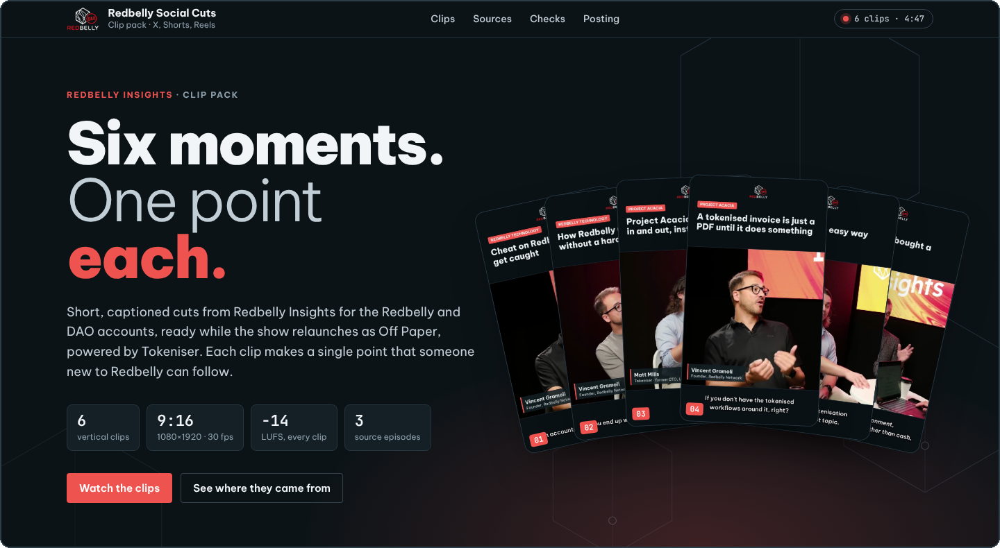
    </picture>
  </a>
</p>

## Overview

Redbelly Insights has a back catalogue of long-form interviews with partners and builders. This pack turns the six strongest moments from the latest episodes into short posts that make one clear point each, so the Redbelly and DAO accounts can share them while the show relaunches as *Off Paper - Powered by Tokeniser*.

Every clip opens on a hook headline with the speaker's name and role, keeps the speaker in frame, and carries subtitles both burned into the picture and as a separate `.srt` file.

## The clips

<table align="center">
  <tr>
    <td align="center"><a href="clips/01.mp4">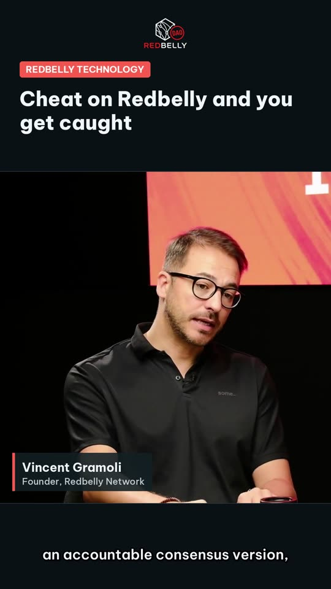</a><br><sub><b>01</b> · 49 s</sub></td>
    <td align="center"><a href="clips/02.mp4">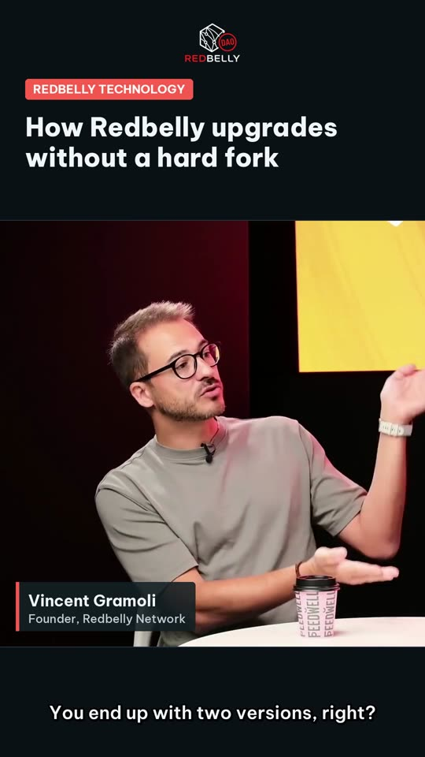</a><br><sub><b>02</b> · 44 s</sub></td>
    <td align="center"><a href="clips/03.mp4">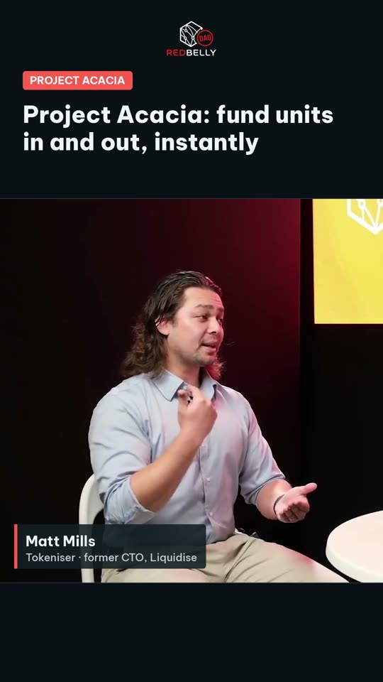</a><br><sub><b>03</b> · 45 s</sub></td>
    <td align="center"><a href="clips/04.mp4">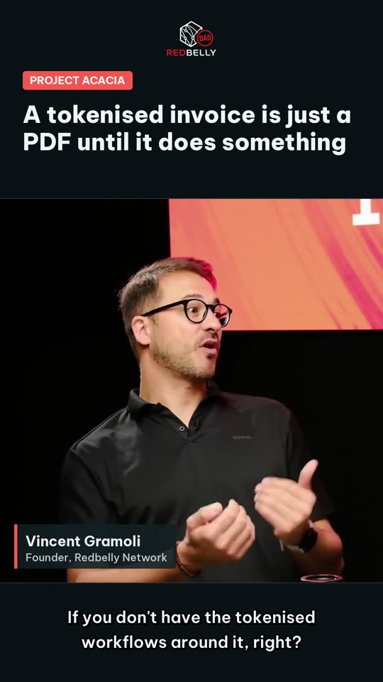</a><br><sub><b>04</b> · 49 s</sub></td>
    <td align="center"><a href="clips/05.mp4">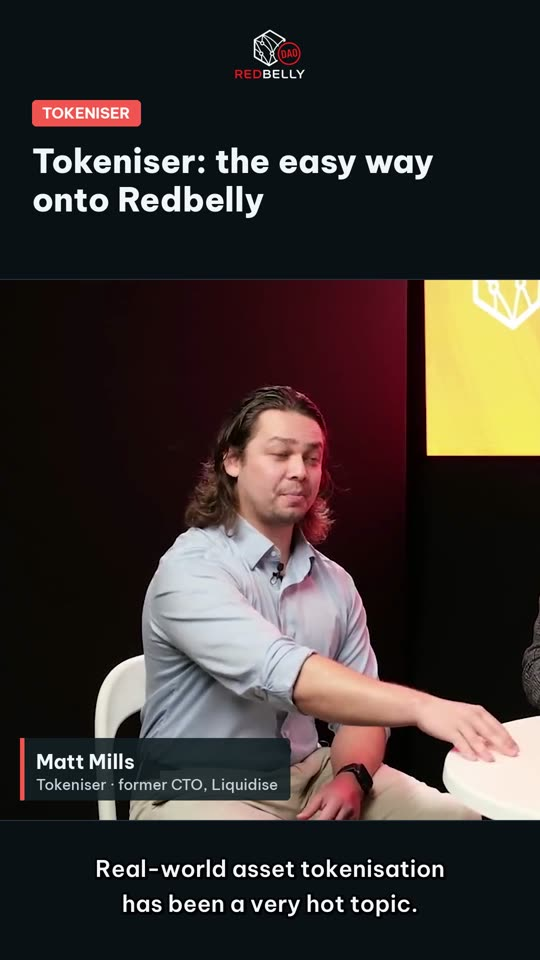</a><br><sub><b>05</b> · 58 s</sub></td>
    <td align="center"><a href="clips/06.mp4">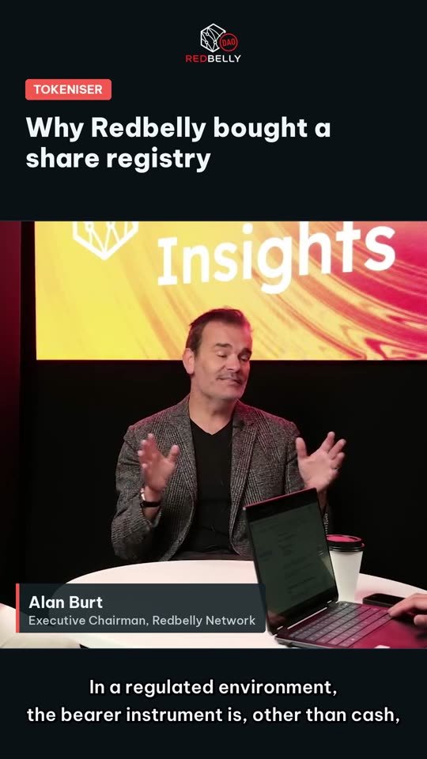</a><br><sub><b>06</b> · 41 s</sub></td>
  </tr>
</table>

| # | Hook | Speaker | Topic | Source | Files |
|---|---|---|---|---|---|
| 01 | Cheat on Redbelly and you get caught | Vincent Gramoli, Founder, Redbelly Network | Redbelly technology | Episode 28 · 12:16.2 | [MP4](clips/01.mp4) · [SRT](clips/01.srt) |
| 02 | How Redbelly upgrades without a hard fork | Vincent Gramoli, Founder, Redbelly Network | Redbelly technology | Episode 25 · 30:51.2 | [MP4](clips/02.mp4) · [SRT](clips/02.srt) |
| 03 | Project Acacia: fund units in and out, instantly | Matt Mills, Tokeniser · former CTO, Liquidise | Project Acacia | Episode 26 · 20:28.7 | [MP4](clips/03.mp4) · [SRT](clips/03.srt) |
| 04 | A tokenised invoice is just a PDF until it does something | Vincent Gramoli, Founder, Redbelly Network | Project Acacia | Episode 28 · 5:39.5 | [MP4](clips/04.mp4) · [SRT](clips/04.srt) |
| 05 | Tokeniser: the easy way onto Redbelly | Matt Mills, Tokeniser · former CTO, Liquidise | Tokeniser | Episode 26 · 7:10.6 | [MP4](clips/05.mp4) · [SRT](clips/05.srt) |
| 06 | Why Redbelly bought a share registry | Alan Burt, Executive Chairman, Redbelly Network | Tokeniser | Episode 26 · 3:28.9 | [MP4](clips/06.mp4) · [SRT](clips/06.srt) |

Full timestamps, source links, the point each clip makes and a suggested post caption for every clip are in [`clip_list.md`](clip_list.md), with the same data as a spreadsheet in [`clip_list.csv`](clip_list.csv).

## Deliverables

| Brief deliverable | Where to find it |
|---|---|
| Six vertical clips with subtitles | [`clips/`](clips): `01.mp4` to `06.mp4` with subtitles burned in, plus a matching `.srt` for each |
| Source episode and timestamp for each clip, with a suggested post caption | [`clip_list.md`](clip_list.md) and [`clip_list.csv`](clip_list.csv) |

## Review site

[`index.html`](index.html) is a single-page review site for the whole pack. It follows the system light or dark theme and works at phone width.

- **Live:** [redbelly-social-cuts.vercel.app](https://redbelly-social-cuts.vercel.app)
- **Locally:** open `index.html` in a browser, or serve the folder:

  ```bash
  python3 -m http.server 8000   # then open http://localhost:8000
  ```

### Every clip with its context

Each clip plays beside the point it makes, the speaker, a cue strip of its subtitles, the source timestamps and a post caption that copies in one click.

<p align="center">
  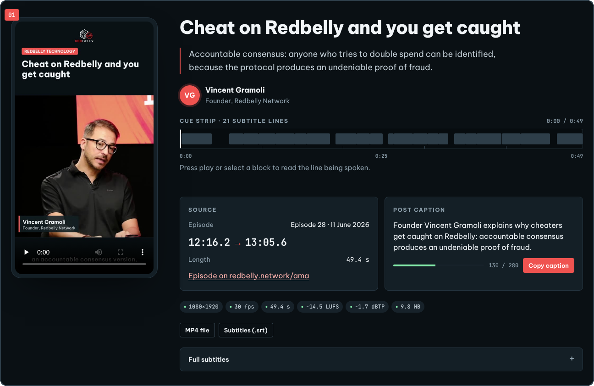
</p>

### Where every clip comes from

Each source episode is drawn to scale, with a red block marking exactly where each clip was cut.

<p align="center">
  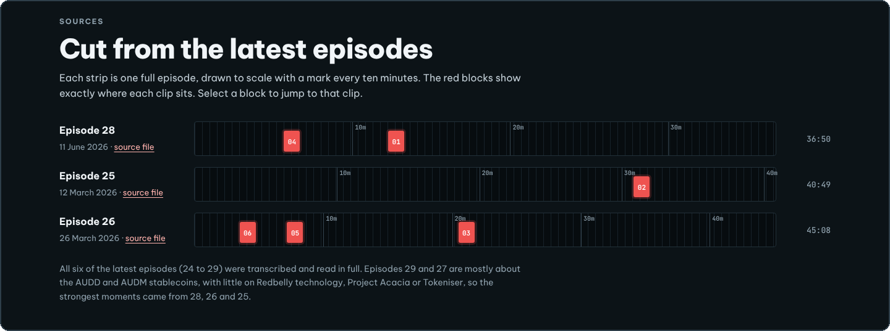
</p>

### Measured, not assumed

Loudness meters, the spec table and the brief requirements, all measured from the exported files.

<p align="center">
  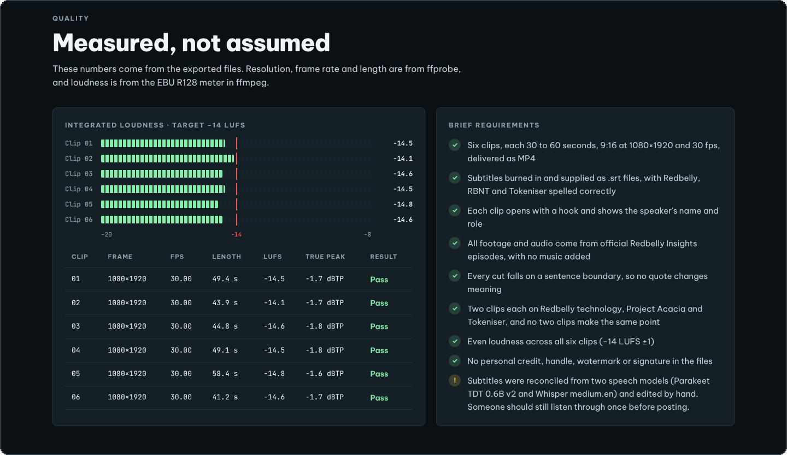
</p>

### On a phone

<p align="center">
  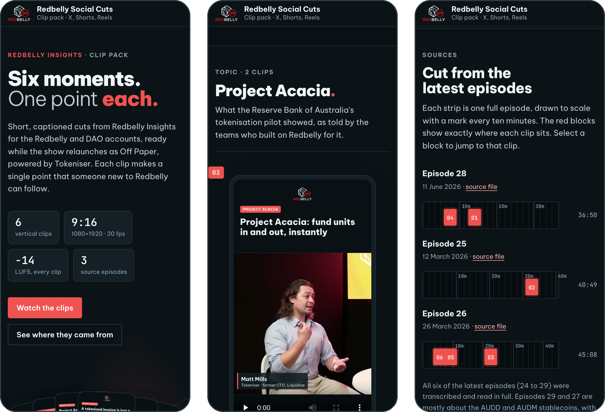
</p>

### Deploying

The site is static, with no build step. Keep `clips/` and `posters/` next to `index.html`.

- **Vercel:** import the repository, choose the *Other* framework preset, leave the build command empty and use the repository root as the output directory.
- **GitHub Pages:** Settings → Pages → Deploy from a branch → `main`, `/ (root)`.
- **Any static host** (Netlify, an S3 bucket): upload the folder as it is.

## Specifications

| Property | Value |
|---|---|
| Aspect ratio | 9:16 |
| Resolution | 1080 × 1920 |
| Frame rate | 30 fps |
| Length | 41 to 58 seconds |
| Format | MP4, H.264 video, AAC 48 kHz stereo audio |
| Loudness | −14 LUFS integrated target (measured −14.1 to −14.8), true peak −1.6 dBTP or lower |
| Subtitles | Burned in, plus SubRip `.srt` per clip |

## Sourcing

The six latest Redbelly Insights episodes (24 to 29) were transcribed and read in full, starting with the most recent. The clips come from episodes 28, 26 and 25, two each on Redbelly technology, Project Acacia and Tokeniser, and no two clips make the same point. Episodes 29 and 27 focus on the AUDD and AUDM stablecoins, with little on the three topics. Names and terms in the subtitles were checked against Redbelly's own pages and the RBA's Project Acacia final report; see [`clip_list.md`](clip_list.md#names-and-terms).

All footage and audio come from official Redbelly Insights episodes published at [redbelly.network/ama](https://redbelly.network/ama). No music has been added.

## Verification

Every claim in the specifications is measured from the exported files, not assumed. [`tools/verify.py`](tools/verify.py) checks each clip against the brief: frame size, frame rate, length, codecs, loudness, subtitle timing, the spelling of Redbelly, Tokeniser and RBNT, credit-free metadata, and a complete row in the clip list.

```bash
python3 tools/verify.py          # print the report; exits with status 1 on any failure
python3 tools/verify.py --write  # also refresh verification.md
```

Requires Python 3.8 or later with `ffmpeg` and `ffprobe` on the PATH. The latest results are in [`verification.md`](verification.md).

## Posting

| Platform | How to post |
|---|---|
| X | Upload the MP4 as it is and paste the suggested caption. Every caption is well under 280 characters. |
| YouTube Shorts | Every file is 9:16 and under 60 seconds, so each one qualifies as a Short. Add the matching `.srt` as a caption track for search and accessibility. |
| Instagram Reels and TikTok | Turn off auto-captions, because the subtitles are already burned in. Pick a cover frame from the first few seconds, while the hook headline is on screen. |

The subtitles are burned in, so every clip reads with the sound off.

## Repository layout

```text
.
├── index.html          Review site (single file, no build step)
├── favicon.svg         Redbelly mark for the browser tab
├── clips/              01.mp4 to 06.mp4 and the matching .srt subtitles
├── posters/            One still frame per clip
├── clip_list.md        Source episode, timestamp, speaker, point and caption for each clip
├── clip_list.csv       The same list as a spreadsheet
├── verification.md     Measured specs and checks for every file
├── docs/
│   └── screenshots/    Screenshots of the review site used in this README
└── tools/
    └── verify.py       Checks the files against the brief and writes verification.md
```

Fonts on the review site load from Google Fonts (Be Vietnam Pro, JetBrains Mono). Everything else is in this repository.
